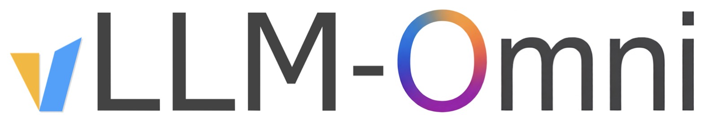
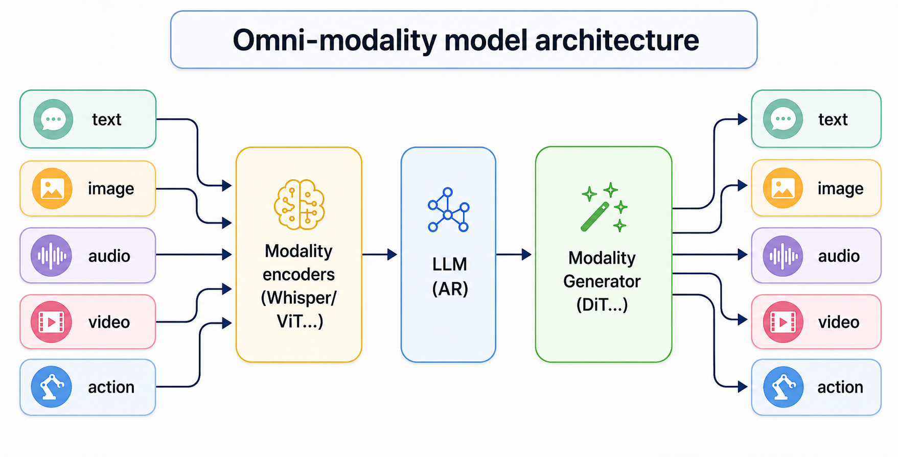

<p align="center">
  <picture>
    <source media="(prefers-color-scheme: dark)" srcset="https://raw.githubusercontent.com/vllm-project/vllm-omni/refs/heads/main/docs/source/logos/vllm-omni-logo.png">
    
  </picture>
</p>
<h3 align="center">
为所有人提供简便、快速且经济高效的全模态模型推理与服务框架
</h3>

<p align="center">
  <a href="https://github.com/vllm-project/vllm-omni/blob/main/README.md">English</a> · <b>简体中文</b>
</p>

<p align="center">
| <a href="https://vllm-omni.readthedocs.io/en/latest/"><b>官方文档</b></a> | <a href="https://deepwiki.com/vllm-project/vllm-omni"><b>DeepWiki</b></a> | <a href="https://discuss.vllm.ai"><b>用户论坛</b></a> | <a href="https://slack.vllm.ai"><b>开发者 Slack</b></a> | <a href="https://github.com/vllm-project/vllm-omni/blob/main/docs/assets/WeChat.jpg"><b>微信群</b></a> | <a href="https://arxiv.org/abs/2610.09307"><b>技术报告</b></a> | <a href="https://arxiv.org/abs/2602.02204"><b>论文</b></a> | <a href="https://docs.google.com/presentation/d/1SV7-4AoSrnK25syLG9XmnEgC0D4lcjP7/edit?usp=sharing"><b>演讲幻灯片</b></a> |
</p>

---

*最新动态* 🔥

- [2026/10] 我们发布了 [0.32.0](https://github.com/vllm-project/vllm-omni/releases/tag/v0.32.0)，与 vLLM 0.32.0 对齐，引入可选的基于 Ray 的多节点推理、基于会话感知的全双工服务运行环境、面向轮询实时请求的服务器端语音活动检测（Server VAD），以及对图像、音乐与语音生成的广泛扩展，支持 YuE2-3B、Qwen-Image-2.1、Kandinsky6、MOSS-Image 与 TaoMate-H3。详见发行说明了解兼容性变更与安装指引。
- [2026/10] 我们发布了 [vLLM-Omni 技术报告](https://arxiv.org/abs/2610.09307)，全面阐述了面向文本、音频、图像、视频及动作（Action）生成的统一服务运行时。
- [2026/09] 我们发布了 [0.30.0](https://github.com/vllm-project/vllm-omni/releases/tag/v0.30.0)，基于 vLLM 0.30.0 完成 Rebase，重点引入围绕引擎专属会话构建的统一全双工服务框架（支持 [MiniCPM-o 4.5](recipes/OpenBMB/MiniCPM-o-4_5.md) 与 AURA）、原生跨阶段 KV 及多模态载荷传输机制（Mooncake AR 到 DiT 任务切换交接与 NIXL 连接器）、交互式世界模型服务（集成 [LingBot World](recipes/Robbyant/LingBot-World-2.0.md)），以及在 NVIDIA Blackwell 与昇腾（Ascend 950）硬件上的实时 [MiniMax H3](recipes/MiniMaxAI/MiniMax-H3.md) Turbo 推理。
- [2026/08] 我们发布了 [0.28.0](https://github.com/vllm-project/vllm-omni/releases/tag/v0.28.0)，包含在 GPU 与 NPU 上生产级可用的 [MiniMax H3](recipes/MiniMaxAI/MiniMax-H3.md) 推理服务、统一的 AR/DiT 分页 KV 缓存运行时，以及针对 [MiniCPM-o 系列](recipes/OpenBMB/MiniCPM-o-4_5.md) 增强的实时全双工服务能力。
- [2026/08] [VeRL-Omni](https://github.com/verl-project/verl-omni) `v0.2.0` 正式发布：由 vLLM-Omni 赋能更快速的扩散强化学习（通过 FA3 实现请求级/步进级批处理）、重构的 Qwen3-Omni 多模态训练（DPO 与 GSPO），并新增对 LTX-2.3、Qwen-Image-Edit 等模型的支持。详见[版本发布说明](https://github.com/verl-project/verl-omni/releases/tag/v0.2.0)。
- [2026/08] 我们发布了 [0.26.0](https://github.com/vllm-project/vllm-omni/releases/tag/v0.26.0) —— 与 vLLM 0.26 发行线对齐，支持 [MiniMax H3](recipes/MiniMaxAI/MiniMax-H3.md) 联合音视频生成、针对 [MiniCPM-o 4.5](recipes/OpenBMB/MiniCPM-o-4_5.md) 的实验性全双工实时运行时、分布式逐层扩散卸载（Layerwise diffusion offload），并扩充了模型、硬件、流式传输、TTS 与量化支持。
- [2026/07] 我们发布了 [0.24.0](https://github.com/vllm-project/vllm-omni/releases/tag/v0.24.0) —— 与 vLLM 0.24 发行线对齐，将生产级覆盖扩展至 TTS、语音、扩散模型、图像/视频生成及机器人策略（Robot-policy）服务，重构了核心 Omni 阶段运行时，引入扩散请求级批处理、异步输出物化、量化/缓存/内存优化，以及广泛的 CUDA/ROCm/XPU/NPU 支持。
- [2026/06] 稳定版本 [0.14.0](https://github.com/vllm-project/vllm-omni/releases/tag/v0.14.0)、[0.16.0](https://github.com/vllm-project/vllm-omni/releases/tag/v0.16.0)、[0.18.0](https://github.com/vllm-project/vllm-omni/releases/tag/v0.18.0)、[0.20.0](https://github.com/vllm-project/vllm-omni/releases/tag/v0.20.0) 与 [0.22.0](https://github.com/vllm-project/vllm-omni/releases/tag/v0.22.0) 发布，与上游 vLLM 的每个偶数次版本对齐，扩展全模态与世界模型服务、TTS、扩散模型、分布式执行、量化、通过 [VeRL-Omni](https://github.com/verl-project/verl-omni) 实现强化学习集成，并支持 CUDA/ROCm/MUSA/NPU/XPU 等多样化硬件加速后端。
- [2026/03] 欢迎观看我们在 vLLM 香港 Meetup 上的首次公开[项目深度剖析演讲](https://youtu.be/sgwNfsNnR9I)！
- [2025/11] vLLM 社区正式发布 [vllm-project/vllm-omni](https://github.com/vllm-project/vllm-omni)，以全面支持全模态大模型的推理与部署服务。

---

## 关于 (About)

[vLLM](https://github.com/vllm-project/vllm) 最初设计用于支持大语言模型在基于文本的自回归（Autoregressive, AR）生成任务中的高效推理。vLLM-Omni 作为一个扩展框架，将这一能力全面拓展至全模态模型的推理与服务：

- **全模态 (Omni-modality)**：覆盖文本、图像、音频、视频以及具身动作（Action）数据的综合处理
- **非自回归架构 (Non-autoregressive Architectures)**：将 vLLM 的自回归（AR）支持拓展至扩散 Transformer（DiT）以及各类并行生成模型
- **异构多模态输出 (Heterogeneous outputs)**：从传统单一文本生成跨越至多模态复合输出与具身智能体动作控制

<p align="center">
  <picture>
    
  </picture>
</p>

vLLM-Omni 具备极致的推理性能：

- **业界顶尖的自回归支持**：深度复用 vLLM 高效的分页键值缓存（Paged KV Cache）管理机制
- **多阶段流水线重叠执行**：流水线阶段间计算与传输相互掩盖重叠，实现高吞吐并发表现
- **基于 OmniConnector 的全解耦架构**：支持跨阶段动态资源分配与完全解耦部署

vLLM-Omni 具备极高的灵活性与易用性：

- **异构流水线抽象**：轻松编排与管理复杂的多模态模型工作流
- **主流 Hugging Face 模型无缝集成**：开箱即用，全面支持生态流行架构
- **丰富的分布式并行推理支持**：张量并行（TP）、流水线并行（PP）、数据并行（DP）与专家并行（EP）
- **实时流式输出**：支持极低延迟的首字与音频/视频流式返回
- **OpenAI 兼容 API 服务器**：平滑替代既有接口，降低迁移改造成本
- **[全双工实时交互服务](docs/serving/realtime_duplex_api.md)**：支持持续音频流输入与伴随式流式输出

vLLM-Omni 原生无缝支持 Hugging Face 上绝大多数主流开源大模型，涵盖：

- **全模态大模型**（例如 Qwen3-Omni、MiniCPM-o 4.5、Cosmos3、HunyuanImage、BAGEL）
- **TTS 语音合成模型**（例如 Qwen3-TTS、Tencent AuK、Breeze-TTS-2、CosyVoice3）
- **扩散生成模型** —— 图像、视频与音频生成（例如 MiniMax H3、LingBot World、MAGI-2、LTX-2.5、Wan2.2）
- **机器人策略与动作模型**（例如 π0.5、GR00T-N1.7、DreamZero-DROID、InternVLA-A1）

## 快速上手 (Getting Started)

访问我们的[官方文档](https://vllm-omni.readthedocs.io/en/latest/)了解更多详情。

- [安装指南](https://vllm-omni.readthedocs.io/en/latest/getting_started/installation/)
- [快速起步](https://vllm-omni.readthedocs.io/en/latest/getting_started/quickstart/)
- [每日构建 CUDA Docker 镜像](https://hub.docker.com/r/vllm/vllm-omni/tags?name=nightly)（基于最新 `main` 分支自动构建）
- [支持模型清单](https://vllm-omni.readthedocs.io/en/latest/models/supported_models/)
- [部署配方库](https://recipes.vllm.ai)（针对各类 vLLM-Omni 模型的生产级部署方案）

## 参与贡献 (Contributing)

我们非常欢迎并高度重视来自社区的任何形式的贡献与合作。
请参阅[为 vLLM-Omni 贡献指南](https://vllm-omni.readthedocs.io/en/latest/contributing/)了解参与方式与开发流程。

## 引用 (Citation)

如果您在学术研究中使用了 vLLM-Omni，请引用我们的[技术报告](https://arxiv.org/abs/2610.09307)与[学术论文](https://arxiv.org/abs/2602.02204)：

```bibtex
@article{vllmomni2026technicalreport,
  title={vLLM-Omni Technical Report: A Unified Serving Runtime for Omni-Modality Generation},
  author={{vLLM-Omni Team}},
  journal={arXiv preprint arXiv:2610.09307},
  year={2026}
}

@article{yin2026vllmomni,
  title={vLLM-Omni: Fully Disaggregated Serving for Any-to-Any Multimodal Models},
  author={Peiqi Yin, Jiangyun Zhu, Han Gao, Chenguang Zheng, Yongxiang Huang, Taichang Zhou, Ruirui Yang, Weizhi Liu, Weiqing Chen, Canlin Guo, Didan Deng, Zifeng Mo, Cong Wang, James Cheng, Roger Wang, Hongsheng Liu},
  journal={arXiv preprint arXiv:2602.02204},
  year={2026}
}
```

## 加入社区 (Join the Community)

欢迎在 [slack.vllm.ai](https://slack.vllm.ai) 上的 `#sig-omni` Slack 频道或 vLLM 官方用户论坛 [discuss.vllm.ai](https://discuss.vllm.ai) 中提出问题、提供反馈并与 vLLM-Omni 社区用户及核心开发者交流探讨。

## Star 增长历史 (Star History)

<a href="https://www.star-history.com/?repos=vllm-project%2Fvllm-omni&type=date&legend=top-left">
  <picture>
    <source media="(prefers-color-scheme: dark)" srcset="https://api.star-history.com/chart?repos=vllm-project/vllm-omni&type=date&theme=dark&legend=top-left&sealed_token=ExgLDZJoQEg27Zfhhut2LqN0GYO6Fw2PWLwPE6JYBUp2BgM3hmsYlwaIVopnUEfbRXidQ4nisumrTdKYydiKhy1SZXipw47qY2_tiUDhCpsPXeXtPuEVKVzBwKs3pw0tiHsJgtSfwXx5yjHXck0Y2SblzFWeJYCkTe1WLGTbUAOIETjXXQJjyCGZvKz5" />
    <source media="(prefers-color-scheme: light)" srcset="https://api.star-history.com/chart?repos=vllm-project/vllm-omni&type=date&legend=top-left&sealed_token=ExgLDZJoQEg27Zfhhut2LqN0GYO6Fw2PWLwPE6JYBUp2BgM3hmsYlwaIVopnUEfbRXidQ4nisumrTdKYydiKhy1SZXipw47qY2_tiUDhCpsPXeXtPuEVKVzBwKs3pw0tiHsJgtSfwXx5yjHXck0Y2SblzFWeJYCkTe1WLGTbUAOIETjXXQJjyCGZvKz5" />
    
  </picture>
</a>

## 开源许可 (License)

遵循 Apache License 2.0 开源许可证，详见 [LICENSE](./LICENSE) 文件。

---

> **免责声明 / Disclaimer**：本文档由社区志愿者维护，致力于提供准确的中文本地化参考。如遇内容更新滞后或歧义，请以 [README.md](https://github.com/vllm-project/vllm-omni/blob/main/README.md) 英文原文为准。
