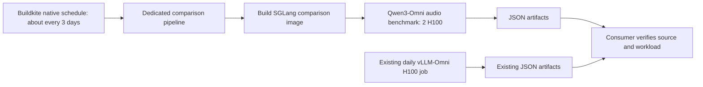

# Scheduled backend comparison

PR #1994 provides a separate SGLang-Omni image and one Qwen3-Omni audio
benchmark on two H100 GPUs. Reuse the existing daily vLLM-Omni H100 artifacts
for the other side of the comparison.



## Administrator setup

Create a dedicated pipeline in Buildkite with these settings. This document
does not create or enable a pipeline or schedule.

| Setting | Value |
| --- | --- |
| Suggested pipeline slug | `vllm-omni-backend-comparison` |
| Repository | `https://github.com/congw729/vllm-omni.git` |
| Default branch | `ci/separate-image` |
| Branch filter | `ci/separate-image` |
| GitHub push and pull-request builds | Disabled |
| Initial steps | The upload step below |

The repository setting makes the agent check out the fork directly. Confirm
that the organization's GitHub integration and agents can read this repository.
Install this initial step in the dedicated pipeline's Buildkite settings:

```yaml
steps:
  - label: ":left_right_arrow: Upload Backend Comparison"
    key: upload-backend-comparison
    commands:
      - buildkite-agent pipeline upload .buildkite/cuda/test-sglang-omni.yml
    agents:
      queue: medium_cpu_queue_premerge
```

The uploaded YAML contains only `image-build-sglang-omni` and
`nightly-sglang-omni-qwen3-omni`. It directly selects the comparison image and
two-GPU H100 pod. The shared `.buildkite/cuda/pipeline.yml` entry routes by PR
labels, which native schedules do not supply; keep the dedicated pipeline on
the direct upload shown above. Shared nightly and NPU settings need no changes.

After the branch contains the reviewed producer changes, create a disabled
Buildkite native schedule on this dedicated pipeline:

| Schedule field | Value |
| --- | --- |
| Label | Qwen3-Omni backend comparison |
| Branch | `ci/separate-image` |
| Commit | `HEAD`, or an administrator-approved fixed runner commit |
| Cron interval | `0 3 */3 * * UTC` |
| Environment variables | Empty |
| Enabled | No, until the acceptance run below passes |

This calendar cron runs at 03:00 UTC on days 1, 4, 7, and so on; the gap at a
month boundary can be shorter than three days. Schedule management requires
Buildkite `write_pipelines`; `write_builds` alone is insufficient. Buildkite
documents the [schedule fields](https://buildkite.com/docs/apis/rest-api/pipeline-schedules)
and [cron semantics](https://buildkite.com/docs/pipelines/configure/workflows/scheduled-builds).

Give the consumer the actual pipeline slug after creation and review its
allowed source configuration: organization, pipeline, repository, branch,
step key, and immutable revision/metadata checks. A suggested slug does not
authorize an existing pipeline with that name. New revisions may be imported
as observations after these checks; equivalent settings across revisions
still require workload and deployment evidence.

Keep the schedule disabled while preparing the first GPU acceptance run.
After the source configuration and version pins are ready, use Buildkite's
**Run now** action for one acceptance build; this consumes two H100 GPUs.
Confirm its resolved fork/branch commit and that it contains only the upload,
image, and target benchmark jobs. Enable the recurring schedule after that
run passes and its artifact passes the consumer checks.

## Workload and version pins

`test_qwen3_omni_sglang.json` selects
`Qwen/Qwen3-Omni-30B-A3B-Instruct`, random multimodal audio, 10 requests at
0.1 requests/second, input/output lengths 100, dataset seed 0, and two warmups.
It requests text and WAV audio with Chelsie, generation seed 42, and the
configured Talker sampling controls. `sgl_qwen3_omni.yaml` places Thinker on
GPU 0 and Talker/Code2Wav on GPU 1, with first/steady/context codec windows
4/25/25. Read those files for the full configuration and memory budgets.

`docker/Dockerfile.other` pins SGLang-Omni to
`22d4ace88f9547777b819a69d7691204bb9ce847` and applies
`docker/patches/sglang-omni-ignore-eos.patch`. A schedule repeats this fixed
backend version. Updating its pin or patch requires a reviewed code change.

As of 2026-10-23, that pin is from 2026-10-14; SGLang-Omni `main` is at
`ca9e8789fcd84ed6f7272276cb99447eec751787` (2026-10-22). Refresh and validate the
pin and ignore-EOS patch before the first scheduled GPU acceptance run. Using
`HEAD` in the schedule follows the comparison branch and does not track
SGLang-Omni `main` automatically.

For vLLM-Omni, select the existing
`nightly-omni-performance-async-chunk` H100 job's **audio** result from
`test_qwen3_omni_async_chunk.json`. That file also produces text-only and other
modality results with similar filenames. Check audio metrics and workload
fields before pairing records. Historical artifacts can omit seed, warmup,
or deployment details; consumers must retain those as unknown unless an
external, reviewed revision profile establishes them.

Check voice selection at the recorded vLLM-Omni revision: the current
Qwen3-Omni default is Ethan, while the comparison request explicitly selects
Chelsie. Shared request counts and chunk sizes do not establish voice
equivalence. Keep these observations labeled with that difference until the
workloads are aligned and validated.

## Artifact metadata contract

Results remain in `tests/dfx/perf/results/*.json`, with the existing metrics
and filename pattern. SGLang runs add an `experiment_metadata` object:

| Field | Meaning |
| --- | --- |
| `schema_version` | Integer `1` |
| `runner_commit` | Actual Git HEAD of the executing test runner checkout |
| `runner_files` | Runner source paths and SHA-256 hashes of their actual bytes |
| `server_type` | `sglang-omni` |
| `server_revision` | Installed server distribution's VCS commit, or `null` when unavailable |
| `num_gpus`, `num_gpus_source` | Declared CUDA card count from `test_config.hardware_marks.num_cards`, or `null`; source records that origin |
| `test_config` | Test JSON path and SHA-256 |
| `server_config` | Selected deployment YAML path and SHA-256, or `null` |
| `server_patches` | Comparison image recipe's patch paths and SHA-256 hashes |
| `workload` | Configured benchmark fields, excluding baselines, with resolved scalar sweep values, warmups, and seed |
| `buildkite` | Build/job IDs, step key, pipeline slug, branch, source, and Buildkite commit |

Missing dataset seeds remain `null`; unbounded request rate is the string
`"inf"`. The server revision is read using the server's Python environment,
which is separate from the vLLM benchmark client environment. A runner
checkout's HEAD and the Buildkite commit are recorded separately. Patch
fingerprints describe the recipe and do not independently prove that a local
installation applied it.

Metadata records provenance. Consumers must independently verify the
Buildkite API's repository/pipeline, branch, successful job, artifact owner,
and immutable commit independently; verify source file hashes against that
revision as well. Matching config hashes alone cannot establish equivalent
behavior if runner code, the benchmark client, or the image recipe changes.
Only pair records whose verified hardware and workload meet the comparison
profile. Preserve a provenance link to each original artifact.
