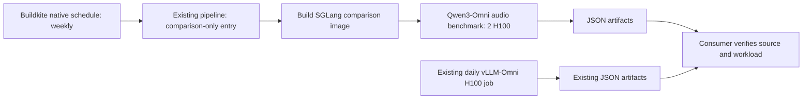

# Scheduled backend comparison

PR #1994 provides a separate SGLang-Omni image and one Qwen3-Omni audio
benchmark on two H100 GPUs. Reuse the existing daily vLLM-Omni H100 artifacts
for the other side of the comparison.



## Administrator setup

Use the existing `vllm/vllm-omni` pipeline. This document and the checked-in
entry prepare the configuration; they do not modify Buildkite settings,
create a schedule or start a build.

| Setting | Value |
| --- | --- |
| Pipeline slug | `vllm-omni` (existing) |
| Repository | Keep `https://github.com/vllm-project/vllm-omni.git` |
| Default branch / GitHub triggers | Keep existing settings |
| Initial steps | Keep the existing Steps unchanged |

The existing initial step checks for `.buildkite/.pipeline_gen_v2` and otherwise
uploads `.buildkite/cuda/pipeline.yml` from the checked-out revision. This PR
does not contain the v2 marker, so its
[CUDA entry](../../../.buildkite/cuda/pipeline.yml) owns the comparison route.
No Settings > Steps change is needed. A regression test checks the marker's
absence; if a future main rebase introduces it, adapt the new generator before
using the schedule. Do not assume the CUDA entry still controls that path.

The entry makes regular and comparison uploads mutually exclusive. A native
comparison request is selected by the dedicated environment flag or PR ref;
invalid combinations stop within that selected route. Existing label-selected
PR comparisons still use the comparison path, and ordinary builds preserve
their original upload command.

The schedule uses GitHub's upstream `refs/pull/1994/head` ref to fetch the
fork's PR head. Do not use `ci/separate-image`, which belongs to the fork,
or the webhook display name `congw729:ci/separate-image` as its branch.
Buildkite resolves `HEAD` after checkout. The uploader embeds that immutable
SHA in `BACKEND_COMPARISON_COMMIT`; both image and benchmark jobs verify their
checkout against it before executing work. Image tags use the same SHA.

The uploaded YAML contains only `image-build-sglang-omni` and
`nightly-sglang-omni-qwen3-omni`. It directly selects the comparison image and
two-GPU H100 pod. Scheduled builds do not require PR labels. This route does
not upload the regular CUDA bootstrap/test pipelines, hardware mirrors or any
NPU pipeline.
Do not change labels to test the schedule: that would create a separate event.

After the branch contains the reviewed producer changes, create a disabled
Buildkite native schedule in **Settings > Schedules**:

| Schedule field | Value |
| --- | --- |
| Label | `Weekly backend comparison` |
| Message | `Scheduled backend comparison` |
| Branch | `refs/pull/1994/head` |
| Commit | `HEAD` |
| Cron interval | `0 3 * * 3` (Wednesday 11:00 Asia/Hong_Kong; default UTC) |
| Environment variables | `BACKEND_COMPARISON_ONLY=1` |
| Enabled | No, until the acceptance run below passes |

Do not copy `NIGHTLY`, `WEEKLY`, `NON_CRITICAL` or `MIRROR_HW` from another
schedule. A comparison request with any of these variables fails before any
test pipeline upload. The PR ref without the comparison flag, a wrong flag value,
a wrong repository/pipeline/ref, or a non-schedule source also fails without
falling through to ordinary CI. Normal builds without the flag or PR ref
retain the existing entry behavior. Schedule management requires
Buildkite `write_pipelines`; `write_builds` alone is insufficient. Buildkite
documents the [schedule fields](https://buildkite.com/docs/apis/rest-api/pipeline-schedules)
and [cron semantics](https://buildkite.com/docs/pipelines/configure/workflows/scheduled-builds).

The kanban consumer must allow the existing `vllm-omni` pipeline with branch
`refs/pull/1994/head`, source `schedule`, the upstream repository and step key
`nightly-sglang-omni-qwen3-omni`. Require experiment metadata v1 and verify
runner/build/job/source identities and immutable configuration hashes.
New revisions may be imported as observations after these checks; equivalent
settings across revisions still require workload and deployment evidence.

Keep the schedule disabled while preparing the first GPU acceptance run.
After the source configuration and version pins are ready, use Buildkite's
**Run now** action for one acceptance build; this consumes two H100 GPUs.
Use **Run now**, which retains source `schedule`; **Run with edits** creates
source `ui` and this entry rejects it. Confirm the resolved PR commit and
that the executed jobs contain only init, the comparison uploader, image and
target benchmark. The regular uploader is condition-skipped. Confirm
no NPU or ordinary CUDA tasks, all 10 requests succeed, JSON is uploaded,
kanban imports it and repeat discovery adds no duplicate. Enable the recurring
schedule after that run passes and its artifact passes the consumer checks.

To pause or remove these weekly tests, disable this schedule. Existing schedules,
Steps and triggers remain unchanged. Routing changes are versioned in PR #1994.

## CPU validation

Requires Python 3.12, pytest, PyYAML, Bash and Git; no GPU or model weights.
The entry tests execute commands with local stubs and never contact
Buildkite. From the repository root:

```bash
python -m pytest --noconftest -o addopts='' \
  tests/buildkite/test_backend_comparison_schedule.py \
  tests/buildkite/test_upload_pipeline.py -m 'core_model and cpu' -q
```

## Workload and version pins

`test_qwen3_omni_sglang.json` selects
`Qwen/Qwen3-Omni-30B-A3B-Instruct`, random multimodal audio, 10 requests at
0.1 requests/second, input/output lengths 100, dataset seed 0, and two warmups.
It requests text and WAV audio with Chelsie, generation seed 42, and the
configured Talker sampling controls. `sgl_qwen3_omni.yaml` places Thinker on
GPU 0 and Talker/Code2Wav on GPU 1, with first/steady/context codec windows
4/25/25. Read those files for the full configuration and memory budgets.

`docker/Dockerfile.other` pins SGLang-Omni to
`137eaa97b7ba426b13aa8837d37c5ba4e0a0daba` (2026-11-03 main) and applies
`docker/patches/sglang-omni-ignore-eos.patch`. A schedule repeats this fixed
backend version. Updating its pin or patch requires a reviewed code change.

The runner baseline is vLLM-Omni main
`2031d5c8d603ec4bd1e4c7471a746d1916843c4c` (2026-11-03), with its vLLM 0.32.0
wheel pin. The server's separate environment uses SGLang 0.5.22, Torch 2.14.1
and Transformers 5.19.0 as required by the pinned SGLang-Omni revision.
Its image follows that revision's base-image digest, UCX commit and protobuf
override, and preserves the matching FlashInfer 0.7.1 AOT packages. The image
build runs CPU checks for ignore-EOS propagation and the two-GPU deployment
configuration; it does not load model weights or run inference.

Using `HEAD` in the schedule follows the comparison branch and does not track
either upstream main automatically. Refresh both revisions before a future
weekly run when current-version measurements are needed.

For vLLM-Omni, select the existing
`nightly-omni-performance-async-chunk` H100 job's **audio** result from
`test_qwen3_omni_async_chunk.json`. That file also produces text-only and other
modality results with similar filenames. Check audio metrics and workload
fields before pairing records. Historical artifacts can omit seed, warmup,
or deployment details; consumers must retain those as unknown unless an
external, reviewed revision profile establishes them.

Check voice selection at the recorded vLLM-Omni revision: the current
Qwen3-Omni default is Ethan, while the comparison request explicitly selects
Chelsie. Shared request counts and chunk sizes do not establish voice
equivalence. Keep these observations labeled with that difference until the
workloads are aligned and validated.

## Artifact metadata contract

Results remain in `tests/dfx/perf/results/*.json`, with the existing metrics
and filename pattern. SGLang runs add an `experiment_metadata` object:

| Field | Meaning |
| --- | --- |
| `schema_version` | Integer `1` |
| `runner_commit` | Actual Git HEAD of the executing test runner checkout |
| `runner_files` | Runner source paths and SHA-256 hashes of their actual bytes |
| `server_type` | `sglang-omni` |
| `server_revision` | Installed server distribution's VCS commit, or `null` when unavailable |
| `num_gpus`, `num_gpus_source` | Declared CUDA card count from `test_config.hardware_marks.num_cards`, or `null`; source records that origin |
| `test_config` | Test JSON path and SHA-256 |
| `server_config` | Selected deployment YAML path and SHA-256, or `null` |
| `server_patches` | Comparison image recipe's patch paths and SHA-256 hashes |
| `workload` | Configured benchmark fields, excluding baselines, with resolved scalar sweep values, warmups, and seed |
| `buildkite` | Build/job IDs, step key, pipeline slug, branch, source, and Buildkite commit |

Missing dataset seeds remain `null`; unbounded request rate is the string
`"inf"`. The server revision is read using the server's Python environment,
which is separate from the vLLM benchmark client environment. A runner
checkout's HEAD and the Buildkite commit are recorded separately. Patch
fingerprints describe the recipe and do not independently prove that a local
installation applied it.

Metadata records provenance. Consumers must independently verify the
Buildkite API's repository/pipeline, branch, successful job, artifact owner,
and immutable commit independently; verify source file hashes against that
revision as well. Matching config hashes alone cannot establish equivalent
behavior if runner code, the benchmark client, or the image recipe changes.
Only pair records whose verified hardware and workload meet the comparison
profile. Preserve a provenance link to each original artifact.
