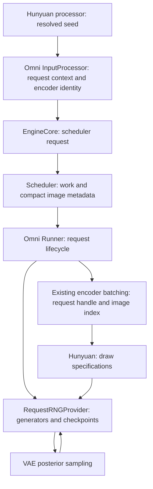

# Request-owned multimodal random streams

HunyuanImage3 conditional VAE sampling uses one random stream per seeded AR
request. Reference images consume that stream in their original request order,
as intended by [#4145](https://github.com/vllm-project/vllm-omni/pull/4145).
[Issue #9362](https://github.com/vllm-project/vllm-omni/issues/9362) exposed that
the previous implementation instead used the first seed for an entire encoder
batch. Its result depended on unrelated requests and which images were cached.

## Ownership and interfaces



The optional `SupportsMMRequestRNG` contract binds a model to a Runner-owned
provider. The model supplies the ordered random draw specifications and the
operation that consumes a skipped draw. The provider owns generators and
checkpoints; it never uses the AR token sampler's generator. Each executing
worker owns device-local objects. Generator objects are not serialized or
transferred between AR and DiT stages.

`MMRNGContext` carries the policy version, the processor's actual seed, and
the names of compact metadata fields needed by the model. Hunyuan emits this
context on every processor invocation, including all-cache-hit invocations.
`OmniInputProcessor` preserves it for both raw prompts and rendered engine
inputs. It delegates tokenization and multimodal preprocessing to the existing
renderer and delegates request construction to upstream vLLM.
For raw prompts, parameter, LoRA and DP-rank checks run before rendering can
mutate the sender cache. A request rejected by these early checks leaves no
unsent image entries that could break the next request's cache lookup.

Before encoder batching, the Runner attaches a CPU `(request_handle, mm_index)`
field to a shallow copy of each scheduled image item. Upstream grouping and
encoding remain responsible for batching and output order. Shared processor
cache items never contain runtime handles. `embed_multimodal(**kwargs)` keeps
its upstream signature.

The draw plan and image-to-draw positions are built once per request. Each
encoder dispatch maps only its scheduled items to original image indices,
using the request ID and encoder identifier returned by upstream batching.
These identities remain aligned through filtering and reordering, independently
of placeholder object identity. Checkpoints are stored in a list whose indices
are consecutive draw boundaries, allowing direct lookup without scanning prior
images or checkpoints. Request updates revalidate the cached plan at the
lifecycle boundary, outside the per-image encoding loop.

`RandomDrawSpec` resolves an accelerator device without an index to the current
device when the specification is constructed. Explicit accelerator indices
remain distinct, and CPU device aliases normalize to `cpu`. The plan and actual
posterior are compared using these fixed devices, so later current-device
changes cannot reinterpret an existing plan.

## Cache behavior and random-stream restoration

Processor `mm_hash` remains unchanged; upstream processor hashing already
includes a supplied `vae_generator_seed` in the processor kwargs. Encoder
`identifier` is derived from
the policy, seed and original identities of the reference prefix through the
current image. Including the original identities preserves existing adapter
scope. The transformation happens before the scheduler constructs KV block
hashes. Request IDs are excluded, so identical reference prefixes can reuse
encoder outputs across requests. Different preceding images conservatively
prevent reuse even if their random draw shapes happen to match.

The reference chain belongs to encoder identities rather than processor
`mm_hash` values. Processor caching also resolves UUID-only inputs whose pixels
are omitted after an earlier request supplied them. A cached image from `[A]`
must still resolve when a later request supplies `[B, A]` with only A's UUID.
Including the reference prefix in the processor key would turn that valid
lookup into a miss with no pixels available to recompute it.

For image `i`, the provider restores the closest checkpoint at or before `i`.
It replays missing predecessor draws using the same shape, dtype, device and
`randn_tensor` operation as the posterior sampler, discarding those temporary
noise tensors. It does not execute the predecessor VAE forwards. Each successful
replayed draw appends a checkpoint. A successful sample appends the next boundary
or replaces it when recomputing an earlier image; an exception in replay or
sampling does not commit the failed draw. A repeated or reordered encoder call
restores its logical position instead of consuming the current tail of the stream.

KV prefix hits can remove image pixels before dispatch. The Omni scheduler
adapter preserves `vae_token_grid_hw` and `vae_generator_seed` from the full
request, independently of M-RoPE configuration. SHM handles stay intact until
the worker's normal receiver resolves them. Hunyuan checks its inferred draw
specification against the actual posterior before sampling.

Pausing or preempting a request preserves its RNG state. Completion and abort
remove it, including steps with zero scheduled tokens. Reusing a request ID
creates a new handle. Worker shutdown clears the remaining state.

## DiT draw order and AR-KV integration

The canonical DiT random stream follows the uncached local execution path:

1. Use the supplied generator, or create the request generator from its seed.
2. Sample each conditional image's VAE posterior in reference order. Repeated
   references consume separate draws. CFG copies the sampled conditioning; it
   does not introduce another posterior draw for each CFG branch.
3. Draw the initial generated-image noise from that same stream, followed by
   any later operations that consume the generator.

The current DiT path skips conditional encoding when imported AR KV or native
KV covers the conditional images. It also skips those posterior draws, so the
initial noise can differ from a local cache miss with the same seed. This is
a pre-existing DiT limitation; the AR request-stream fix does not resolve it.
Seed-scoped cache keys alone do not restore a skipped random-stream position.

The integration in [#9192](https://github.com/vllm-project/vllm-omni/issues/9192)
must preserve the canonical order when reusing conditional KV. Replay should
consume and discard the same `randn_tensor` calls as the actual posterior,
without repeating VAE forwards, or restore an equivalent validated RNG state.
Its draw specifications must match the executing VAE's shape, dtype and device,
including autocast behavior. A VAE backend returning tensors directly must be
handled according to its own sampling behavior; the wrapper does not call
`latent_dist.sample` in that branch. Replaying the ordinary posterior draw
unconditionally would therefore be incorrect.

Acceptance coverage for that integration must compare local misses, native
prefix hits and AR-KV imports at the initial noise and subsequent generator
state, with the same seed or supplied generator state. Include repeated and
different-sized references, all CFG branches, and the supported VAE backends.
Imported conditioning must also have the matching reference and sampling
identity; matching the DiT noise alone does not establish AR-to-DiT parity.

Unseeded behavior currently differs between stages. AR retains its existing
global-RNG sampling and image-based encoder identity, allowing a previously
sampled embedding and its KV to be reused. DiT native prefix identities use an
explicit generator's state when supplied; with neither generator nor seed,
reference identities are request-local. These are compatibility behaviors,
not a shared seedless reuse contract. Before combining the caches, #9192 must
define how a seedless request identifies its realized conditioning across the
stage boundary and test that unrelated requests cannot exchange it. This PR
does not change either stage's seedless policy.

## Compatibility and validation boundary

The legacy Omni GPU and NPU runners bind request RNG during model loading.
MRv2 does not yet carry the request context and per-image RNG indices, so it
rejects models declaring this capability at startup. Use `model_runner: v1`
for a Hunyuan AR stage. This avoids accepting requests into an unsupported
runner and discovering the missing provider during worker execution.

The existing seed-forwarding paths are preserved. A delivered seed, including
zero, enables the request stream. The processor validates the signed 64-bit
seed before updating its cache. Admission also validates the model's RNG
policy and available per-image seed/grid metadata, including manually rendered
engine inputs; malformed values produce request validation errors. Cached or
SHM payloads are resolved by their normal receivers, and worker-side checks
remain to detect internal inconsistencies. Absent seeds retain `generator=None`
and global RNG behavior; DiT and token-sampling RNG are unchanged.

Seeded engine inputs must retain the processor-produced context. The reference
list and sampling plan remain fixed within a request; incompatible updates are
rejected before reusing its cached plan.

Regression tests use production processing, cache, scheduling, batching and
posterior sampling with tiny network substitutes. Comparisons are exact within
one device and dtype; they do not assert equality between CPU/CUDA or different
precisions. These tests establish RNG and lifecycle behavior, not pretrained
Hunyuan image quality, distributed performance, or AR-to-DiT integration.
Additional CPU tests exercise GPU/NPU model-load wiring and MRv2 startup
rejection. A randomly initialized `AutoencoderKLConv3D` checks the draw plan
and replay with the model's spatial/temporal compression and latent channels,
using smaller hidden widths and image dimensions in FP32 and BF16. This is
actual VAE encoding evidence, not a production-resolution or pretrained test.
CPU cases cover request lifecycle, cache transport and plan reuse. CUDA cases
focus on mixed-request sampling and missing-predecessor replay, each in FP32,
FP16 and BF16.

Run from the repository root with the supported vLLM and Omni dependencies:

```bash
python -m pytest tests/inputs/test_mm_rng.py tests/model_executor/models/test_hunyuan_request_rng.py -m 'core_model and cpu' -q
python -m pytest tests/model_executor/models/test_hunyuan_request_rng.py -m 'core_model and cuda and L4' --run-level=core_model -q
```

The CUDA tests require one CUDA GPU and no model weights; the L4 mark selects
the existing CI runner tier. Both test paths are already collected by the
CPU and model-executor CUDA sweeps in `test-ready.yml`.
