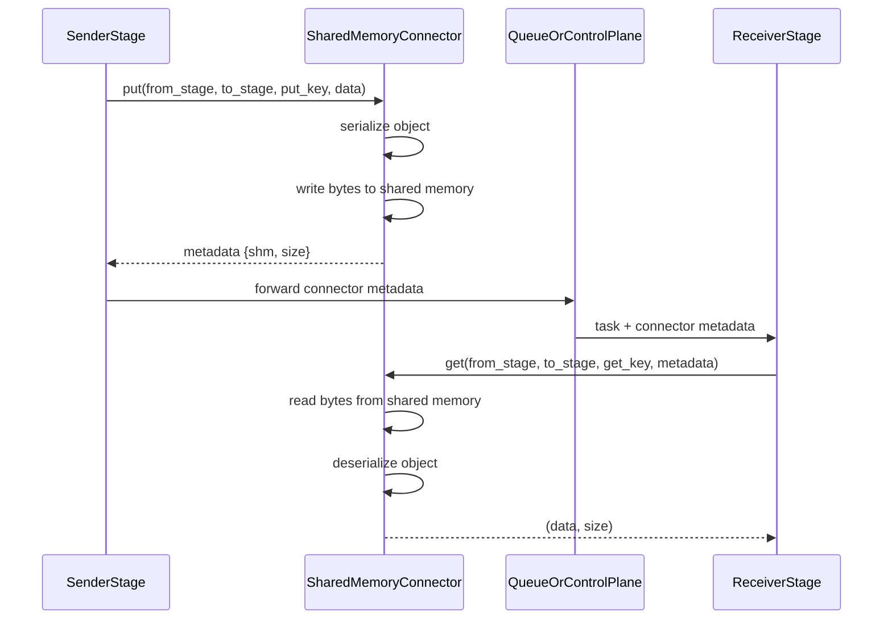

# SharedMemoryConnector

## When to Use

Best for single-node deployments where stages run on the same host. It is
auto-configured when no explicit connector is specified for an edge.

## How It Works

All payloads are serialized and stored in shared memory; the SHM segment name
is returned in metadata. The default Linux implementation uses `/dev/shm`.

## Configuration

```yaml
connectors:
  connector_of_shared_memory:
    name: SharedMemoryConnector
```

## Notes

- Auto-mode uses SharedMemoryConnector if no connector is declared for an edge.

---

## Design

### 1. Overview

`SharedMemoryConnector` is the default same-node connector in `vllm_omni/distributed/omni_connectors`. It is designed for stage-to-stage transfer when producer and consumer processes run on the same host and can access the same shared-memory segments.

The connector provides a unified `put()` / `get()` API for arbitrary Python objects while keeping the control plane lightweight:

- The payload is serialized by the connector.
- The serialized bytes are placed in shared memory.
- The queue/control plane only carries a small metadata handle.

This makes `SharedMemoryConnector` the simplest connector in the OmniConnector family and the default fallback when an edge does not explicitly configure another backend.

### 2. Relationship with the OmniConnector System

`SharedMemoryConnector` implements `OmniConnectorBase`, so it follows the same lifecycle and API contract as the other connectors:

- `put(from_stage, to_stage, put_key, data)`
- `get(from_stage, to_stage, get_key, metadata=None)`
- `cleanup(request_id)`
- `health()`
- `close()`

Within the larger system:

- `load_omni_transfer_config()` automatically fills missing edges with `SharedMemoryConnector`.
- Stages transfer payloads through `put()` and `get()`. On request completion or abort, the sender
  can reclaim the chunks it published.

Compared with the remote Mooncake-based connectors, `SharedMemoryConnector` is intentionally minimal and local-only.

### 3. Design Goals

The connector is built around the following goals:

- **Low-friction local transfer** for single-node multi-process pipelines.
- **Unified object semantics** for arbitrary Python payloads.
- **Small control-plane overhead** by passing only metadata through queues.
- **Zero external dependencies** beyond Python shared memory and the existing stage utilities.

It is not intended to provide cross-node transfer, RDMA, or raw tensor zero-copy semantics across processes.

### 4. Core Design

#### 4.1 Serialization Model

`SharedMemoryConnector` serializes the Python object into the sending thread's reusable buffer:

```python
buffer = self._thread_encode_buffer()
size = self._serde.serialize_into(data, buffer)
payload = memoryview(buffer)[:size]
```

This keeps the connector behavior consistent with the rest of the connector stack:

- producer code does not need connector-specific serialization logic
- consumer code always receives the original object after deserialization
- the connector can reuse the same serializer used by other backends

#### 4.2 Shared Memory as the Data Plane

The actual data plane is a shared-memory segment created by:

- `shm_write_bytes(...)`
- `shm_read_bytes(...)`

The connector stores a small metadata object such as:

```python
{
    "shm": {"name": ..., "size": ...},
    "size": ...
}
```

This metadata is passed over the control plane and allows the downstream stage to locate the shared-memory segment.

#### 4.3 Locking Model

On Linux, the default connector uses one lock file per shared-memory segment name.

```text
/dev/shm/shm_{segment_name}_lockfile.lock
```

The writer waits for an exclusive `flock` and checks that the file it locked still has the same
device and inode as the file at that path. If the path changed while the writer was waiting, the
writer reopens it before publishing. The reader tries a nonblocking exclusive `flock` before
opening the segment.

The orphan checks below use the default file-backed layout to establish that a segment is absent.
Backends with custom segment existence checks or lock paths skip those checks. When a backend
stores segments elsewhere, use a separate lock directory or a filename pattern outside
`shm_*_lockfile.lock` to keep its live locks out of the default connector's scan.

### 5. Put / Get Flow

#### 5.1 Producer Flow: `put()`

The producer-side flow is:

1. Serialize the input object to bytes.
2. Compute the payload size.
3. Acquire the lock for this transfer key and verify its identity.
4. Write the bytes into shared memory. If the write fails and the segment is absent, the writer
   attempts to remove the lock while holding it. A surviving segment keeps its lock.
5. Return lightweight metadata to the caller.

The returned tuple is:

```python
(success, serialized_size, metadata)
```

where `metadata` contains the shared-memory handle needed by the consumer.

#### 5.2 Reading with a SHM Handle

When the metadata contains a SHM handle, the reader uses its segment name:

1. Extract the shared-memory handle from `metadata`.
2. Acquire the nonblocking exclusive lock.
3. Copy the bytes. The default connector unlinks the segment before returning them. If it has
   already disappeared at unlink time, the read succeeds. Other unlink errors leave the lock and
   tracking record in place while the segment still exists, so the receiver can retry.
4. While holding the lock, verify that the path still names the same file and attempt to remove it.
5. Release the lock and deserialize the bytes. Deserialization can fail after the bytes have been read.

If the read fails and the supplied handle's segment has disappeared, the reader can reclaim the
orphan lock immediately while holding it.

#### 5.3 Reading by Transfer Key

When the metadata is absent or contains only source host/port information, streaming receivers locate the chunk by key:

1. Acquire the segment's nonblocking exclusive lock.
2. Open and read the segment after the writer has sized and populated it.
3. Deserialize the bytes and return the object.

If the writer holds the lock or the segment is absent, the call returns `None`
so the receiver can retry later. A key-only poll can reclaim an orphan lock once its modification
time is at least 60 seconds old. A failed read leaves a live segment's lock in place for a later
attempt.

`get_with_deadline()` follows the same per-key read path and skips the directory scan. It checks
the monotonic deadline on entry and again under the verified lock before reading. If time has run
out, the payload remains available to a later call. A read that has already started can finish
copying and deserializing its payload.

### 6. Key Implementation Characteristics

#### 6.1 All Payloads Use Shared Memory

`put()` writes every serialized payload to shared memory. The connector has no
inline-payload path or size threshold.

#### 6.2 Explicit Cleanup and Orphan Locks

`cleanup(key)` tries the exact key's exclusive lock without waiting, even if another sender published it.
If the lock is busy, it returns `False` and the caller can retry. Cleanup removes the lock and
tracking record only after unlinking the segment or confirming its absence. Other storage errors
preserve both. Acquiring the lock can briefly create its file if the path is missing.

Under the publication lock, `put()` records the segment's stable identity (device and inode on
the default Linux backend). If the backend supplies no identity or the lookup fails, `put()`
still returns the handle and discards any previous record for that key. Completion, abort and
`close()` skip that publication. The receiver can still consume it with `get()`, and callers
can explicitly release it with `cleanup(key)`.

Prefix cleanup selects tracked keys whose suffix is a numeric chunk ID. Before unlinking a
tracked segment, the sender checks its identity under the lock. If a peer has replaced it,
the sender retires the old record and leaves the replacement and its lock untouched.

The V1 chunk adapter processes aborts and completions on its send thread. The native model
runner v2 (MRv2) handles release requests under the lock that also protects request registration
and output state. Both paths try each publication lock without waiting, so a peer holding one
chunk's lock cannot stall unrelated requests. If a release arrives before an MRv2 request's
terminal delivery, MRv2 records it and tries cleanup when that delivery finishes. Prefix cleanup
counts only segments removed during the call.

When a tracked publication's lock is busy, the sender schedules cleanup for retry during later
`put()` calls or from its idle send loop. If a retry encounters a temporary error opening the
lock, checking the segment's identity or unlinking the segment, the publication stays scheduled
for a later pass after the retry delay. An idle MRv2 sender checks at most four records per pass
and waits at least 100 ms between passes.

A crashed process can leave a lock file behind after its segment disappears. With the default
file layout, initialization, `put()` and ordinary `get()` can trigger a scan of the lock directory. Each
process scans a directory at most once per 60 seconds. The triggering call walks the whole
directory synchronously. For an empty regular lock file at least 60 seconds old, the scan tries a
nonblocking exclusive lock. Before removing the lock, it checks that the current user owns the
file, its identity and age still match, and the segment is still absent. An idle connector waits
until its next operation to scan again.

#### 6.3 Closing the Connector

`close()` makes one nonblocking cleanup attempt per tracked publication, including deferred
releases. It leaves a busy segment and its lock available to the peer, continues to other
publications, then removes its own visibility marker and closes its wakeup FIFO. A stopped
sender has no idle loop to retry a skipped release. An unread segment can therefore remain
after shutdown.

On Linux, independently launched Python processes can have separate resource trackers.
If an old publisher exits after a peer has reused its segment name, its `resource_tracker`
can unlink the replacement by name without taking the connector lock. The lock file can
remain even though a new reader can no longer open the segment.

### 7. Data Flow in the Pipeline

When a stage passes the SHM handle over the control plane, the flow is:



This is a classic split-control-plane / data-plane design, but constrained to a single host.

### 8. Strengths and Trade-offs

#### Strengths

- Very simple deployment model.
- No external service dependency.
- Fits naturally into the existing queue-driven orchestration flow.
- Good default for local multi-process pipelines.

#### Trade-offs

- Same-node only.
- Full object serialization and deserialization are still required.
- Orphan lock recovery is best effort. An untracked segment that still exists lies outside the
  lock scan.
- Shared memory capacity is limited by host configuration.

### 9. Summary

`SharedMemoryConnector` is the baseline local transport for the OmniConnector system. Its design is intentionally straightforward:

- serialize object
- place bytes in shared memory
- pass metadata through the control plane
- deserialize on the receiving side

It plays two important roles in vLLM-Omni:

1. It is the simplest production-ready connector for same-node stage pipelines.
2. It serves as the automatic fallback connector when no explicit edge transport is configured.

Although the current implementation is deliberately minimal, it provides the foundation for reliable local connector semantics and keeps the stage communication model uniform across the system.
