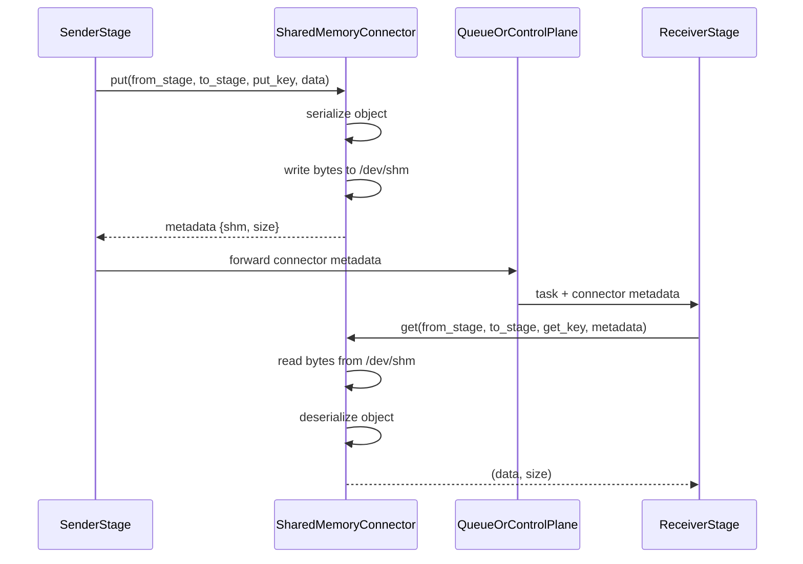

# SharedMemoryConnector

## When to Use

Best for single-node deployments where stages run on the same host. It is
auto-configured when no explicit connector is specified for an edge.

## How It Works

All payloads are serialized and stored in shared memory (`/dev/shm`); the SHM
segment name is returned in metadata.

## Configuration

```yaml
connectors:
  connector_of_shared_memory:
    name: SharedMemoryConnector
```

## Notes

- Auto-mode uses SharedMemoryConnector if no connector is declared for an edge.

---

## Design

### 1. Overview

`SharedMemoryConnector` is the default same-node connector in `vllm_omni/distributed/omni_connectors`. It is designed for stage-to-stage transfer when producer and consumer processes run on the same host and can share `/dev/shm`.

The connector provides a unified `put()` / `get()` API for arbitrary Python objects while keeping the control plane lightweight:

- The payload is serialized by the connector.
- The serialized bytes are placed in shared memory.
- The queue/control plane only carries a small metadata handle.

This makes `SharedMemoryConnector` the simplest connector in the OmniConnector family and the default fallback when an edge does not explicitly configure another backend.

### 2. Relationship with the OmniConnector System

`SharedMemoryConnector` implements `OmniConnectorBase`, so it follows the same lifecycle and API contract as the other connectors:

- `put(from_stage, to_stage, put_key, data)`
- `get(from_stage, to_stage, get_key, metadata=None)`
- `cleanup(request_id)`
- `health()`
- `close()`

Within the larger system:

- `load_omni_transfer_config()` automatically fills missing edges with `SharedMemoryConnector`.
- Callers interact with the connector exclusively through the `put()` / `get()` / `cleanup()` contract — the connector does not require caller-specific logic.

Compared with the remote Mooncake-based connectors, `SharedMemoryConnector` is intentionally minimal and local-only.

### 3. Design Goals

The connector is built around the following goals:

- **Low-friction local transfer** for single-node multi-process pipelines.
- **Unified object semantics** for arbitrary Python payloads.
- **Small control-plane overhead** by passing only metadata through queues.
- **Zero external dependencies** beyond Python shared memory and the existing stage utilities.

It is not intended to provide cross-node transfer, RDMA, or raw tensor zero-copy semantics across processes.

### 4. Core Design

#### 4.1 Serialization Model

`SharedMemoryConnector` always starts from a Python object and serializes it through the shared Omni serializer:

```python
payload = self.serialize_obj(data)
```

This keeps the connector behavior consistent with the rest of the connector stack:

- producer code does not need connector-specific serialization logic
- consumer code always receives the original object after deserialization
- the connector can reuse the same serializer used by other backends

#### 4.2 Shared Memory as the Data Plane

The actual data plane is a shared-memory segment created by:

- `shm_write_bytes(...)`
- `shm_read_bytes(...)`

The connector stores a small metadata object such as:

```python
{
    "shm": {"name": ..., "size": ...},
    "size": ...
}
```

This metadata is passed over the control plane and allows the downstream stage to locate the shared-memory segment.

#### 4.3 Locking Model

To avoid races between the producer and consumer, the connector uses a lock file per transfer (one per key):

```text
/dev/shm/shm_{put_key}_lockfile.lock
```

Locking is done with `fcntl.flock`:

- producer uses `LOCK_EX` (blocks until acquired)
- consumer uses `LOCK_EX | LOCK_NB` — a contended lock is not waited on: the read returns `None` and never touches the lock

Both sides acquire an exclusive lock. This ensures that the shared-memory segment is not read while it is still being written and makes the handoff safer in a multi-process environment.

Lock-file lifecycle: a lock file has no purpose of its own — it only serializes one transfer, and its reclamation is tied to the segment's, best-effort rather than strict co-presence: a lock may briefly exist before its segment is created and may outlive a reaped segment until a removal path runs. Removal is *attempted*, never guaranteed (failures are swallowed), on: a receiving byte read that returned successfully (`consumed` is set before deserialization, so a later deserialize failure still removes the lock); a read that acquired the lock and then found the segment already gone — both read-path removals run before `LOCK_UN` and re-check the lock file's `(st_ino, st_dev)`, so a lock recreated under the key by a later transfer is never deleted; a key-based poll whose segment is missing, reclaiming an aged orphan; a `put()` whose `shm_write_bytes` raised and left no segment under the key (a helper that raised *after* creating one keeps the lock, so the half-written segment and its lock are reclaimed together); and `cleanup()` / `close()`. Sweeping is lazy and per-process — not a background timer: `_maybe_sweep_stale_lock_files()` fires from `__init__` / `put()` / `get()` at most once per grace interval (a monotonic-clock trigger rate limit, distinct from the orphan-age test, which compares the lock file's mtime against the wall clock). The gate re-arms, so a restart inside the grace window retries young orphans on later calls; with no further calls, or if removals keep failing, no reclamation time is guaranteed. A lock whose segment was reaped externally (e.g. by `resource_tracker` at owner shutdown — itself best-effort) becomes an orphan candidate, reaped with a check–lock–recheck protocol that never touches a young, held, or live-segment lock.

#### 4.4 Key Generation

Connector keys carry a per-admission generation token:

```text
{external_req_id}_{stage_id}_{transfer_gen}_{chunk_id}
```

The orchestrator mints a fresh token (`uuid4().hex[:8]`) once per admission
and stamps it into `payload_sender_info["transfer_gen"]` on every stage
request it builds from that admission; the sending stage and the receiving
stage read the same value off their own request objects
(`_request_transfer_gen`), so a re-used external request id derives fresh
keys per admission instead of replaying a previous generation's key
sequence (a collision would need two admissions of the same id to draw the
same 8-hex token). The orchestrator's release RPC carries the token of the
generation it is reclaiming, so a delayed release for an old generation
cannot match a newer generation's keys. `"0"` is the fallback for requests
that carry no stamp (unit tests, legacy admission paths).

### 5. Put / Get Flow

#### 5.1 Producer Flow: `put()`

The producer-side flow is:

1. Serialize the input object to bytes.
2. Compute the payload size.
3. Acquire the per-request lock file.
4. Write the bytes into shared memory. If this write raises, the lock file is removed while still holding it — but only when the write left no segment under the key. A helper that raises *after* creating the segment keeps the lock, so the half-written segment and its lock are reclaimed together by a later path (best-effort); failures before the lock file is created (e.g. serialization) have nothing to clean up.
5. Return lightweight metadata to the caller.

The returned tuple is:

```python
(success, serialized_size, metadata)
```

where `metadata` contains the shared-memory handle needed by the consumer.

#### 5.2 Consumer Flow: `get(metadata=...)`

The primary consumer path is metadata-driven:

1. Extract the shared-memory handle from `metadata`.
2. Acquire the exclusive lock.
3. Read the raw bytes from shared memory.
4. Deserialize the bytes back into the original Python object.
5. Attempt to remove the lock file while still holding it — after a byte read that returned successfully (a later deserialize failure does not change this) or after a failed read whose segment is already gone — and only after re-checking the lock file's `(st_ino, st_dev)`, so a lock file recreated under the key by a later transfer is never deleted; keep it while the segment still exists so the transfer can be retried — a read blocked on the lock never touches it.

This is the path used by the current stage-to-stage connector flow.

#### 5.3 Compatibility Flow: `get(metadata=None)`

The connector also keeps a compatibility path for callers that only know the key:

1. Attempt to open the shared-memory segment by name via `SharedMemory(name=get_key)`.
2. If the segment exists and has non-zero size, acquire the exclusive lock and read the bytes.
3. Deserialize the bytes and return the object.

If the segment does not exist or any exception occurs, the call returns `None` immediately. There is no retry loop in this path -- it is a single-attempt open. When the segment is missing (e.g. it was reaped by `resource_tracker` after an abnormal owner exit — itself best-effort), the poll additionally tries to reclaim the orphan lock file once it is older than the 60 s grace window (age is the lock file's mtime against the wall clock; the grace protects a concurrent `put()` between its `open()` and `flock()`).

This path is mainly for older code paths and is not the preferred mode for the current connector pipeline.

### 6. Key Implementation Characteristics

#### 6.1 All Payloads Use Shared Memory

`put()` writes every serialized payload to shared memory. The connector has no
inline-payload path or size threshold.

#### 6.2 Cleanup Unlinks the Exact Key

`cleanup(request_id)` attempts exact-key cleanup for the key passed to `put()` — never a request-id prefix: it pops the tracking record, tries to unlink the segment, then tries to remove the lock file — even when the segment cleanup failed, and without keeping a failure record for a later retry ("segment still exists, lock removed" is possible). It returns whether a segment was actually unlinked. The cleanup is unconditional: the key does not need to be tracked in this connector's `_pending_keys`, so a caller may also target a key it only knows by name. `cleanup_prefix()` and `close()` are the tracked-key operations: the former cleans up only tracked keys of the form `{key_prefix}{chunk_id}`, the latter drains the keys tracked at close time (§6.3). A key the consumer never reads and nobody cleans up stays allocated until the sender's `close()` — or the orphan sweep, once its segment is gone (§4.3).

#### 6.3 Close Drains Tracked Keys and Wakeups

`close()` snapshots the keys currently tracked in `_pending_keys`, runs the exact-key cleanup for each, then closes the receiver's wakeup FIFO. There is no connector-owned background thread or memory pool, and `close()` does not scan for or guarantee cleanup of untracked leftovers. Crash leftovers beyond the tracked keys are left to the time-gated orphan sweep (best-effort, §4.3).

### 7. Data Flow in the Pipeline

The typical flow with `SharedMemoryConnector` is:



This is a classic split-control-plane / data-plane design, but constrained to a single host.

### 8. Strengths and Trade-offs

#### Strengths

- Very simple deployment model.
- No external service dependency.
- Fits naturally into the existing queue-driven orchestration flow.
- Good default for local multi-process pipelines.

#### Trade-offs

- Same-node only.
- Full object serialization and deserialization are still required.
- Resource reclamation is best-effort on every path: the consumer read is
  the primary one; failed puts, dead-segment reads, the time-gated sweep,
  and the orchestrator's release RPC cover the failure and crash paths —
  but no path guarantees a reclamation deadline.
- Shared memory capacity is limited by host configuration.

### 9. Summary

`SharedMemoryConnector` is the baseline local transport for the OmniConnector system. Its design is intentionally straightforward:

- serialize object
- place bytes in shared memory
- pass metadata through the control plane
- deserialize on the receiving side

It plays two important roles in vLLM-Omni:

1. It is the simplest production-ready connector for same-node stage pipelines.
2. It serves as the automatic fallback connector when no explicit edge transport is configured.

Although the current implementation is deliberately minimal, it provides the foundation for reliable local connector semantics and keeps the stage communication model uniform across the system.
