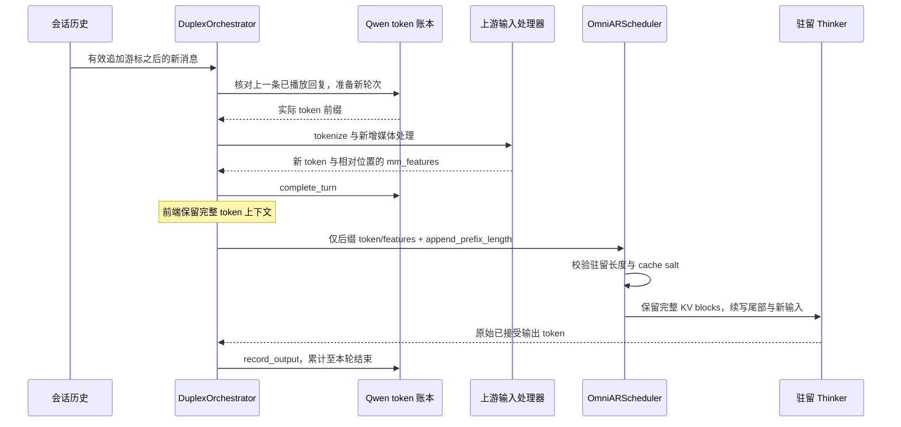

# Qwen3-Omni 全双工跨轮 KV 续写设计

本文描述 [PR #9825](https://github.com/vllm-project/vllm-omni/pull/9825)
的直接追加设计（在 `d4cb78a5f1` 基础上继续改造）。PR 当前为 Draft。
目标是减少多轮语音对话中 Thinker 对历史上下文的重复 prefill，降低 commit 到首个音频包的延迟。
当前验证证明了续写路径可以执行；延迟收益和数值等价性仍需专项验证。

## 设计决策

在一个 session epoch 内保留同一个 resumable Thinker 请求。正常完成一轮后，
下一轮只处理并发送新增 token 和媒体特征，在已有 KV 后续写。
历史发生变化或不满足直接追加条件时，使用完整快照进行校验或重建。

沿用现有部署配置，不增加 YAML 或公共续写开关。Prefix caching 保持开启：
正常追加不比较完整历史的 block hash，但上游仍维护 APC 所需的 hash。
Talker 和 Code2Wav 继续按轮创建请求；Thinker KV 与阶段输出缓存共同保证下游所需的历史条件信息。

## 三类状态与所有权

| 状态 | 所有者 | 用途 |
| --- | --- | --- |
| 会话历史 | Duplex 会话层 | 保存用户输入、assistant 文本及播放校准后的有效历史，构造下一轮上下文 |
| 输入与输出 token 账本 | 请求所属的 `QwenIncrementalPrompt` | 保存已处理输入 token 和实际接受的输出 token，核对上一轮回复并提供驻留前缀 |
| KV、计算进度和物化媒体特征 | EngineCore 的驻留 Thinker 请求 | 作为实际续写基底，由 scheduler 管理 GPU block 和请求生命周期 |

会话历史决定“下一轮应该看到什么”，token 账本用于判断该历史能否接在已生成序列后，
GPU KV 保存实际计算结果。三者不能互相替代：尤其不能把 assistant 文本重新 tokenize
后的结果当作实际生成 token，也不能只凭相同音频占位符判断媒体内容一致。

## 正常续写数据流



首轮没有可复用账本，按完整输入处理并创建驻留请求。
后续输出在输出处理器转换之前进入账本，避免文本解码、聚合或末包截取丢失实际 token 序列。

### 追加资格

会话层、模型策略和 token 账本分别验证以下条件：

1. tokenizer 不隐式插入会破坏追加语义的 BOS/EOS，且 `<|im_end|>` 能作为单 token 边界。
2. 会话追加游标有效：已提交的旧消息未被修改或删除，请求身份保持一致。
3. 上一轮已完成，实际输出最后一个 token 为 `<|im_end|>`。
4. 上一条已播放 assistant 文本与实际输出 token 的解码结果一致。
5. 模板配置未改变，当前不涉及工具消息，且未触发现有消息／音频窗口裁剪。

正常路径只读取游标后的上一条 assistant 消息及新增 user 消息。
旧消息更新或删除会使游标失效；准备期间发生历史变更时拒绝提交增量，允许调用方重试。
增量提交携带准备时的历史版本，校验覆盖等待输入处理锁、tokenizer 和多模态预处理。
预处理返回后，在更新已接受 token 账本和发送 EngineCore 之前再次校验；拒绝时保留上一轮的
完成／传输退休状态，由输入处理守卫回滚未发送的媒体缓存访问，允许后续完整快照重试。
输入成功提交后才更新游标。窗口裁剪、工具消息及配置变化仍走完整快照，不能把这些变化忽略后继续追加。

图片由会话入口限制：已有历史与新增输入合计超过 8 张图片或 4 MiB 时，
拒绝新增 item，要求客户端先删除旧 item。删除旧图片会使追加游标失效，
下一轮通过完整快照重建上下文；不能通过跨轮 delta 绕过该图片限制。

vLLM tokenizer 的 special-token 列表可能不包含 `<|im_start|>`。
这可以使文本前缀分词优化不可用，但不单独禁止实际 token 序列续写。

正常轮次不构造完整历史快照、不比较旧历史前缀，也不重新渲染或解码旧媒体。会话仍保留历史作为异常重建依据。

### 结束 token 与追加内容

令 `P` 为上一轮经过多模态处理后的输入 token，`G` 为实际接受的生成 token，
其最后一个 token 为结束符。前端保留的实际前缀为：

```text
prefix = P + G[:-1]
delta_text = "<|im_end|>\n" + 新一轮渲染内容
frontend_prompt_ids = prefix + processed_delta_ids
append_prefix_length = len(prefix)
```

上游 resumable 更新会丢弃最后一个尚未计算 KV 的采样 token，因此结束符需要在新增输入中补入一次。
不会把已生成的 assistant 正文重新分词来替换 `G[:-1]`。

### 媒体、前端与传输视图

会话层直接选出新轮次的媒体；只有这些新增项访问上游输入处理器，媒体 UUID 也只为新增输入生成。
发送端与接收端多模态缓存观察到相同的新媒体访问，旧物化特征仍由驻留请求持有。
新特征的位置最初相对于新增输入，scheduler 再将其偏移到完整序列位置。

前端输出处理和下游 prewarm 需要完整 token 上下文。
`OmniEngineCoreRequest.for_engine_submission()` 为 EngineCore 创建后缀传输视图，
保留前端请求不变。传输副本设置 `resume_from_full_prompt=False`，
并携带 `append_prefix_length`；scheduler 优先识别该字段并进入直接追加路径。

这里的直接追加指 token 与多模态特征增量。媒体 embedding 的生成仍由现有模型处理链负责，
并未引入客户端直接提交任意 embedding 的新接口。

## Scheduler 与 APC 的配合

直接追加先验证：

```text
confirmed = num_computed_tokens - num_output_placeholders
append_prefix_length == confirmed
incoming.cache_salt == resident.cache_salt
retained = floor(confirmed / block_size) * block_size
```

`confirmed` 排除异步调度尚未完成的占位 token。验证通过后，scheduler 将驻留序列和新增输入合并为
内部更新视图，复用共同的 resumable 更新逻辑。驻留 hash 直接从原请求读取，无需复制到临时快照。

只保留完整 KV block；不足一个 block 的尾部连同新输入重新计算。
Omni 的阶段输出缓存重放已缓存的历史 hidden states，供本轮新建的 Talker 使用。
这解释了为什么保留 Thinker KV 仍需要 APC 和阶段输出缓存，为什么追加也可能有少量尾部重算。

更新过程中清理旧 encoder cache 索引，克隆需要重定位的媒体描述符，避免修改调用方数据。
轮次切换还重置 worker 的交付状态并丢弃上一轮在途输出，之后交给上游 streaming update 扩展序列和 hash。

## 回退、错误和生命周期

| 情况 | 处理方式 |
| --- | --- |
| 首轮、历史编辑或裁剪、媒体变化、播放校准改变 assistant 文本 | 完整快照处理 |
| 未正常完成、结束边界或 tokenizer 行为不满足追加条件 | 完整快照处理 |
| 完整快照的已完成 block hash 全部匹配且输入继续延长 | 保留匹配的完整 KV blocks，重算尾部和后缀 |
| 完整快照不匹配 | 释放旧分配，从当前上下文重建 |
| 已发送 delta，但驻留请求不存在、长度或 salt 不匹配 | 请求级错误；禁止把后缀作为独立新会话执行 |
| cancel／中断导致 epoch 切换 | abort 旧驻留请求；新 epoch 从新账本和完整输入开始 |
| close／会话过期 | 释放驻留请求及其资源 |

完整快照回退会比较含媒体身份和 cache salt 的 block hash。
它可以复用匹配的 KV，因此“回退完整快照”不等于每次都从零 prefill。
服务端发现 delta 基底失效时不能自动用该 delta 重建，因为传输内容不包含完整历史。

驻留请求在空闲期间仍占用 GPU KV 和上游 active-request 名额。
启动校验每副本会话上限不超过 `max_num_active_seqs`，未设置时使用 `max_num_seqs`。

Talker 或 Code2Wav 的提前结束不代表 Thinker 已完成。最终音频包先由 orchestrator
暂存，直到 Thinker 的 segment stop 和最后文本进入会话队列，再交付轮次结束。
等待期间不阻塞会话 mailbox，取消和关闭仍可处理；同 ID 的完整快照回退也不能跳过此边界。

轮次结束后，先停止下游请求，再通过各绑定副本的 `omni_finish_turn` RPC 确认旧传输已退役。
V1 在发送线程完成 SHM 回收及其后续清理任务后确认；MRv2 只退役 native transport，
拒绝旧账本所属的排队输出并回收未消费 SHM，不释放 Thinker scheduler KV。
只有全部确认成功后才允许下一轮复用 ID；超时或失败不得继续复用。
这里不能使用普通请求结束时的异步 best-effort 清理，否则迟到的清理可能删除下一轮 chunk。

## 适用范围与 MiniCPM 对比

续写能力由现有引擎设置决定：V1 或 CUDA MRv2、APC、async-chunk，且无 speculative decoding。
支持同步和异步 scheduling；不支持的组合退回每轮请求模式。

MRv2 的 native data plane 将驻留 Thinker 映射为每轮独立的下游传输，
在 segment stop 后发送 terminal，但不释放 scheduler 的驻留 KV。
同 ID 重装先清理旧传输再注册新 token 账本，排队输出按所属请求状态隔离，
防止旧轮次结果污染新轮次；阶段输出缓存沿用 MRv2 的前缀重放机制。
本次适配的 CPU 验证不代表 CUDA 实权重、多模态数值等价或延迟收益验证。
本设计面向 duplex 路径，不把普通非 streaming 请求统一改为 resumable。

下表比较本仓库 Qwen3-Omni duplex 与 MiniCPM-o 4.5 的原生流式接入，
不泛指所有 MiniCPM 部署或后端。

| 维度 | Qwen3-Omni 本 PR | MiniCPM-o 4.5 原生流式接入 |
| --- | --- | --- |
| 共享思路 | 驻留请求上追加新增输入 | 驻留 Stage0 上追加流式输入 |
| 输入单元 | commit 后的新一轮文本和媒体 | 模型原生流式数据单元，由模型适配逻辑处理 |
| 历史边界 | 会话游标与失效通知、上一轮实际生成 token | 模型专属的流式 prompt、listen/speak 与窗口逻辑 |
| 连续性检查 | 游标有效性与上一条回复检查，EngineCore 校验长度和 salt | 按原生单元与模型状态维护连续性 |
| 可直接共用的部分 | 上游 resumable 调度、KV 生命周期机制 | 同类引擎机制 |
| 不可直接照搬的部分 | Thinker/Talker 分工、模板结束符和阶段输出重放 | MiniCPM 专属输入布局与窗口策略 |

二者在“已有 KV 后追加新输入”上保持一致，但 Qwen 当前仍采用 commit 触发生成，
并未因此获得 MiniCPM 模型原生的连续听说语义。

## 实现索引

以下路径均相对于仓库根目录：

| 文件／符号 | 职责 |
| --- | --- |
| `vllm_omni/model_executor/models/qwen3_omni/duplex/incremental_prompt.py` | token 账本、上一轮回复校验、分词回退 |
| `vllm_omni/model_executor/models/qwen3_omni/duplex/plugin.py` | 新轮次渲染、窗口和工具回退策略 |
| `vllm_omni/engine/duplex/plugin.py`：`DuplexTurnContinuation` | 模型提供的输出记录与轮次准备协议 |
| `vllm_omni/engine/duplex_orchestrator.py` | 输出记录、线程锁内预处理、账本更新 |
| `vllm_omni/engine/__init__.py`：`OmniEngineCoreRequest` | 前端完整上下文与 EngineCore 后缀视图 |
| `vllm_omni/engine/stage_pool.py` | 分别向输出处理器和 EngineCore 提交对应视图 |
| `vllm_omni/request.py` | 续写字段进入请求和 streaming update |
| `vllm_omni/core/sched/omni_ar_scheduler.py` | delta 校验、快照回退、驻留 KV 更新 |

## 验证与待完成项

MRv2 适配的本地 CPU 验证：数据传输、前缀缓存、配置与 orchestrator 共 **227 passed**；
续写 scheduler 共 **11 passed**；共享 streaming scheduler 与 AR/generation runner 共 **199 passed**。
调度器测试在 Ascend 容器中通过外部 harness 禁用了 Ascend 专属 admission 配置，
仍使用真实上游调度器和 KV allocator；这不属于 CUDA MRv2 设备执行证据。
回归覆盖每轮 terminal、停止 token/长度后的输出截断、同 ID 先退役后注册、
旧轮次排队输出隔离，以及保留 KV 的追加、编辑和缩短上下文。
CUDA 实权重的多轮音频/图像、中断、数值等价和性能验证仍待完成。

以下为 MRv2 适配前的 V1 验证记录：

本轮直接追加改造的 CPU 回归 **2,125 passed、64 deselected**，耗时 370.45 秒；
范围包括 Qwen3-Omni 模型、duplex orchestrator、全部 engine duplex 用例及续写 scheduler。
五轮集成用例断言正常轮次不调用 `history_snapshot`、每轮只解码一段新音频，
第五段音频触发四段音频窗口的完整快照回退。另覆盖历史修改失效、回复占位位置、
实际 token 保留、多模态位置与 hash、异步旧输出清理等行为。提交前静态检查通过。

真实模型六轮对话测试 **1 passed、68 deselected**，耗时 281.76 秒。
第二至第四轮的输入均仅包含新音频、不包含旧图像，确认三次直接追加；
第五、第六轮恢复完整窗口输入。六轮使用同一驻留 Thinker 请求。
环境为 vLLM 0.32.0、两张 NVIDIA L20X、`Qwen/Qwen3-Omni-30B-A3B-Instruct`。
该验证覆盖输入增量与窗口回退，不等同于数值等价或延迟收益评测。

合入前还需完成：与完整重建的数值对照、新图像与中断场景验证、
commit 到首音频延迟和内存对比，以及 V1/MRv2 与 APC 组合回归。

相关契约：[全双工运行时](../fullduplex.md)、
[APC 与阶段输出缓存](prefix_caching.md)、
[Realtime Duplex API](../../serving/realtime_duplex_api.md)。
