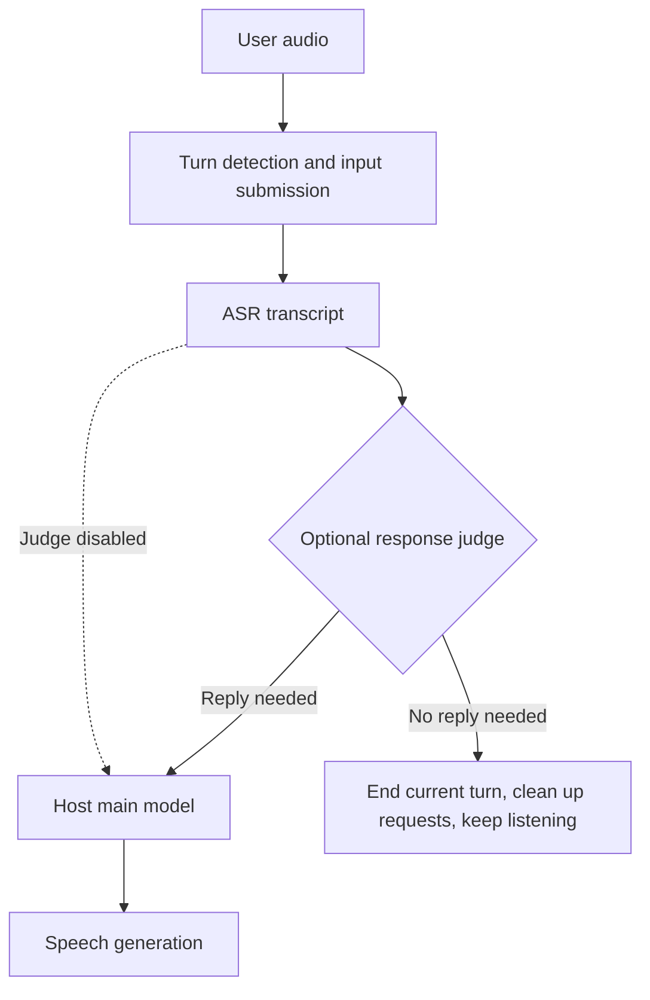

# Response Judge Stage

In a realtime voice pipeline, deciding when a user has finished speaking
does not necessarily decide whether the assistant should reply. A complete
utterance can be a backchannel ("uh-huh", "okay") or speech addressed to
someone else. Submitting it for reply generation can produce an unwanted
response.

A **response judge** is an optional stage placed right after the ASR stage. A
small judge model reads the ASR transcript and decides whether the turn needs
a reply. A rejected turn skips subsequent normal reply generation; any
prewarmed downstream requests are cancelled and released. Additional judge
models can be integrated through the stage's model and
decision interfaces, including chat models that answer with one token and
pooling (decision / scoring) models. Already integrated judges are selected
through deployment configuration; new models require adapter code as
described under "Adding a judge".



This is the logical decision order; streaming ASR may overlap audio input.
The host controls turn submission. AURA is the demonstrated host integration,
with Qwen3 or LAYA selectable as the judge.

## Relationship to VAD and semantic VAD

| Component | Question it answers | Current behavior |
| --- | --- | --- |
| Acoustic VAD / `server_vad` | Is speech present, and has silence lasted long enough to end a turn? | Silero detects speech; the server detector applies silence rules. |
| `semantic_vad` | Does this pause mean the speaker has finished? | Silero finds candidate pauses; Smart Turn scores completion from audio. An incomplete turn waits for resumed speech or the maximum silence timeout. |
| Response judge | Does this submitted transcript need an assistant reply? | A separate model reads the transcript; rejection ends the current turn through the existing cleanup and listen paths. |

For example, "okay" can be a complete utterance without needing a reply.
Conversely, it can confirm an action and require a response. Completion and
reply relevance are different decisions, and the current transcript-only
judge cannot resolve all context-dependent cases.

This comparison describes the current vLLM-Omni implementation, not every
system called semantic VAD. Here, semantic VAD uses audio rather than the ASR
transcript and requires a turn-based (committing) session; native
auto-responding sessions do not support it. Combining it with a judged
pipeline requires validating that session mode.

The judge does not control speech onset or undo an interruption: an overlap
policy may already have triggered barge-in before ASR produces the transcript.
Measure turn completion, unnecessary replies, missed replies and interruption
behavior separately. A detector commit is not evidence that the downstream
assistant actually replied.

## Behavior

- **Opt-in.** Only pipelines that declare a `response_judge` stage run it.
  The judged pipeline is a separate deploy config; the original one is
  unchanged and loads no judge model.
- **Reuses the existing no-reply paths.** In a duplex session a rejected turn
  takes the model's existing listen decision: the client receives
  `response.listen`, prewarmed downstream requests are aborted and released,
  and the turn ends. The event carries
  `response.metadata.vllm_omni.listen_source: "response_judge"`, so a client
  can tell a judge rejection from the model's own decision to stay silent
  (AURA reports `"aura_silent"`). The field is optional and its value is an
  open string set by the plugin; clients should ignore values they do not
  know. In turn-based serving the judge's bridge yields no input
  and the request finishes through the orchestrator's existing empty-output
  path, which also aborts any downstream stage that async-chunk already
  prewarmed.
- **Lets the turn through when unsure.** An empty transcript or an answer
  that cannot be read lets the turn through with the original transcript. A
  failing judge stage uses the existing stage failure handling.
- **The main model sees the ASR output unchanged.** The judge's own output is
  never passed downstream.
- **The judge reads only the current transcript**, not the conversation
  history. A rejected turn is not added to the model's history.

## Judge models

The judge is configured on its own stage in the deploy config, under
`hf_overrides.response_judge`:

| `format` | Model | Runner | Decision |
| --- | --- | --- | --- |
| `chat_yes_no` | Any chat model; `ResponseJudgeQwen3ForCausalLM` for Qwen3 | generate (`max_tokens: 1`) | Rejects `reject_label` (default `NO`), optionally followed by punctuation |
| `laya` | LAYA decision models, `LayaDecisionModel` | pooling (`task: classify`) | Rejects when P(`reply_option`) < `threshold` |

Options per format:

- `chat_yes_no`: `system_prompt`, `user_template` (with `{transcript}`), and
  `reject_label`. The chat template is rendered with thinking disabled, so
  the first generated token is the answer.
- `laya`: `question_type`, `instructions`, `options` (key -> description),
  `reply_option`, `threshold` and `state_template`. `question_type` defaults
  to the model's `laya_question_type`; if both are set they must agree.

`reply_option` may be a list; the probabilities of the listed options are
added. Quote YAML option keys such as `"yes"` and `"no"`, and their
`reply_option` values, so YAML does not convert them to booleans.
LAYA `question_type` accepts only `choice`, `score` and `noul`; integer IDs
are rejected. The prompt and model head use the same validated type.

Both prompt templates are trial-rendered at startup with `{transcript}`.
Escape literal braces as `{{` and `}}`; unknown placeholders and malformed
format strings are rejected before the first turn. Chat answers such as
`NO.`, `No,` and `NO。` reject the turn, while prose such as `NO, actually YES`
remains ambiguous and lets the turn through.

LAYA requires `enable_chunked_prefill: false` and
`max_num_batched_tokens >= max_model_len` so each encoder
prompt fits in one prefill step. An insufficient budget fails at model
initialization, before constructing the encoder.

LAYA score calibration: this adapter returns raw option logits and ignores
the checkpoint's `temperature` buffer. The bridge computes
`softmax(logits)` (effective temperature `T = 1`), rather than
`softmax(logits / T)`. If the LAYA SDK uses a checkpoint temperature other
than 1, its probabilities and threshold-based decisions can differ here.
Do not reuse an SDK-calibrated `threshold` without validation: retune it
using this adapter's scores on representative tuning data for your
checkpoint, prompt and options, then validate on a separate held-out set.
The current example uses `T = 1`, so this
temperature difference does not affect it. Temperature scaling is not
configurable in this adapter.

The LAYA example pins stage 1 to `dtype: float16`, independently of the
pipeline-wide deploy dtype. Scores near the threshold can change enough
under `bfloat16` to flip a decision. Explicit runtime/CLI overrides can still
replace the stage dtype; validate scores and threshold decisions again when
changing precision. This setting does not address classification errors
caused by missing context or the model itself.

For `laya`, the server refuses to start if `options` is empty,
`reply_option` names an option that is not configured, or `threshold` is not
a number in [0, 1]. Loading also fails if a judge head weight does not have
exactly the shape the model expects.

LAYA loads from a directory prepared for vLLM: the checkpoint's weights,
`config.json` with `architectures: [LayaDecisionModel]` and
`laya_question_type`, and the tokenizer files at the top level of the
directory.

## Example: AURA

`vllm_omni/deploy/aura_omni_judged.yaml` serves the `aura_omni_judged`
pipeline:

```text
Qwen3-ASR -> response judge -> AURA -> Qwen3-TTS Talker -> Code2Wav
```

It uses Qwen3-1.7B as the judge:

```yaml
  - stage_id: 1
    model: Qwen/Qwen3-1.7B
    hf_overrides:
      response_judge:
        format: chat_yes_no
    default_sampling_params:
      temperature: 0.0
      max_tokens: 1
```

`aura_omni_judged_laya.yaml` inherits it with `base_config` and replaces only
stage 1 with the LAYA pooling judge. Serve
`aura_omni.yaml` to run AURA without a judge.

## Adding a judge

- **Another chat model:** the `aura_omni_judged` pipeline defaults stage 1
  to `model_arch: ResponseJudgeQwen3ForCausalLM`, so a non-Qwen3 judge must
  also set `model_arch`. The omni runner passes extra keyword arguments to
  `forward` and `compute_logits`; a model class that does not accept them
  needs a thin subclass like `ResponseJudgeQwen3ForCausalLM`, registered in
  `vllm_omni/model_executor/models/registry.py`:

    ```yaml
      - stage_id: 1
        model: <chat model>
        model_arch: <registered judge class>
        hf_overrides:
          response_judge:
            format: chat_yes_no
            system_prompt: "..."
        default_sampling_params:
          temperature: 0.0
          max_tokens: 1
    ```

- **Another pooling model:** add a pooling model class that returns one logit
  per option, and a format entry in
  `vllm_omni/model_executor/stage_input_processors/response_judge.py` that
  builds its prompt and reads its decision.
- **Another pipeline:** add a stage with `model_stage="response_judge"` right
  after the ASR stage. Build its input with `judge_input(...)`, and wrap the
  pipeline's original ASR -> main-model bridge with `after_judge(...)`. A
  duplex plugin that addresses stages by number must account for the extra
  stage (AURA uses a role-based stage layout).

## Latency

The judge runs once per committed turn, on the critical path before the main
model. Measured on AURA with the LAYA judge (one RTX 4080 SUPER, compact
profile, one session at a time), most of its time was the model call, so:

- **Give the judge CUDA graphs that cover its prompt.** vLLM's default capture
  sizes stop at `2 * max_num_seqs`, while a judge prompt without a prefix cache
  is one prefill of tens of tokens. `aura_omni_judged_laya.yaml` therefore
  sets `compilation_config.cudagraph_capture_sizes`. With it the LAYA forward
  pass dropped from about 18 ms to about 8 ms in the pipeline. For the Qwen3
  judge, larger capture sizes showed no gain in a standalone test, so
  `aura_omni_judged.yaml` keeps the defaults.
- **Keep event-driven orchestration on.** It is the default
  (`VLLM_OMNI_EVENT_DRIVEN_ORCH=0` selects the legacy loop): the orchestrator
  picks up each stage's output as it arrives instead of on a 1 ms poll of
  every stage. It cut the judge stage's output pickup from about 4 ms to
  about 1 ms.
- **Expect host effects after idle gaps.** On a host with the `powersave` CPU
  governor, a judge call after a pause in the conversation was slower than
  back to back: about 3x for Qwen3 and up to 4x for LAYA. This
  is consistent with the CPU clocking back up; it was not compared against
  another governor.

With the first two settings, the added latency (from forwarding the ASR
output to submitting the main model, judge on vs. off, 16 questions per arm)
went from 43.0 and 44.5 ms to 26.1 and 28.5 ms p50 in two repeats.

## Limitations

- The judge only sees the transcript, so it cannot use acoustic cues such as
  laughter or who is speaking.
- Judge quality depends on the model and the prompt. Zero-shot decision
  models such as LAYA are weak at "does this need a reply"; fine-tuning their
  heads is future work.
- Short answers to a question from the previous turn ("seven", "tomorrow")
  and interruptions ("wait") look like backchannels without the previous
  turn. The LAYA example prompt still rejects some of them.
- A request id carries one judged turn at a time; a request must not send a
  new transcript to the judge before the previous one has been decided.
- The judge adds its own latency and GPU memory to every committed turn.
- Rejecting an utterance does not prevent an earlier barge-in. A future
  overlap policy could use the judge decision, but waiting until commit and
  judgment would also delay real interruptions. An instruction such as
  "stop" needs a distinct stop-without-reply action rather than being treated
  as an ordinary backchannel.
- Side-talk descriptions in the prompt do not guarantee rejection. Requests
  addressed to a family member can still exceed the reply threshold. Raising
  that threshold requires checking normal questions as well as side talk.
