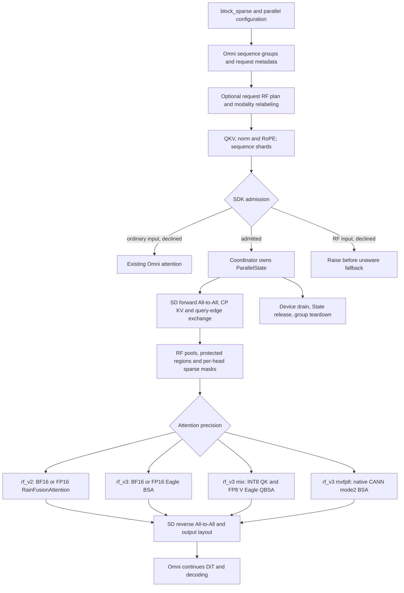

# MiniMax-H3 MindIE-SD parallel attention

Omni delegates complete parallel attention to MindIE-SD and retains request layout, admission and State lifetime. Enable it with `block_sparse.parallel` using the supported providers below.

## Requirements and configuration

Use a matching MindIE-SD `lly/minimax-h3-u8-kvgather2-20261110` build and native plugin/OPP.
It must expose `mindiesd.build_rf_attention_plan` and `mindiesd.parallel.{ParallelState, distributed_sparse_attention}`:

| Path | `sparse_type` | `precision` | `bsa_backend` | Communication | Hardware |
| --- | --- | --- | --- | --- | --- |
| RainFusionAttention | `rf_v2` | `bf16` / `fp16` | `cann` | BF16 / FP16 Q/K/V | A2 / A3 |
| Eagle BSA | `rf_v3` | `bf16` / `fp16` | `eagle` | BF16 / FP16 Q/K/V | A2 / A3 |
| Eagle QBSA | `rf_v3` | `mix` | `eagle` | BF16; optionally INT8 Q/K, FP8 V | A5 |
| Native MXFP8 BSA | `rf_v3` | `mxfp8` | `cann` | BF16; optionally MXFP8 Q/K/V and E8M0 scales | A5 |

`bsa_backend` defaults to the table's provider; conflicting providers or algorithm/precision tuples fail configuration.
Admission requires Ascend NPU, equal `[1,S_local,H,D]` Q/K/V, strict Ulysses and
heads divisible by its degree. FP16 converts BF16 producer operands explicitly
and restores the producer dtype; quantized paths consume BF16 producer tensors.
Pure Ulysses sets `cp_group=None` in `ParallelState` and accepts either RF input order.
CP x Ulysses uses the existing `ulysses_allgather_kv` strategy and supplies the
coordinator's orthogonal `allgather_group` as `ParallelState.cp_group`. It requires
`pre_rearranged=True`, Ulysses degree 4 or 8, CP degree 2 or 4, global sequence
world 8, 16 or 32, and D128. MXFP8 also requires D128 in pure Ulysses.
Ring, paged/reference KV, joint attention, VDN and gate compression are unsupported.
RF hoisting requires compatible settings on every main-DiT layer, no attention schedule and one request per forward.

```json
{
  "default": {
    "backend": "RAINFUSION_ATTN",
    "block_sparse": {
      "sparsity": 0.8,
      "precision": "bf16",
      "sparse_type": "rf_v3",
      "parallel": {
        "overlap_comm": true,
        "rainfusion_reorder_hoist": true,
        "optimize_attention_pipeline": true
      }
    }
  }
}
```

Omit `parallel` to retain ordinary Omni attention. `overlap_comm=false` selects
the SDK serial schedule for diagnosis. All three controls default to true.
With overlap enabled, the SDK submits all forward transfers before computing
the ready chunks. `optimize_attention_pipeline` enables SDK preparation/buffer
reuse and can be disabled explicitly. `rainfusion_reorder_hoist` builds the RF plan once
before RoPE, relabels text/image/audio/output positions and lets SD skip per-layer
row permutation while preserving RF order. Sparse step/layer gates still apply.

For mix and native MXFP8, `block_sparse.parallel.quantized_comm` defaults to `false`: Q/K/V communicate in BF16 and are quantized after communication for the selected BSA consumer. Set it to `true` to retain quantized communication (INT8 Q/K and FP8 V for mix; MXFP8 payloads and E8M0 scales for MXFP8). This flag is independent of `precision`, overlap and the B optimizations and must agree across workers.

## Execution and state ownership

Original-order refusals allocate no state and submit no collectives. RF-reordered refusals raise before fallback.
Execution failures poison the shared resource and propagate without collective retry.

The SP coordinator owns one `ParallelState` per Ulysses group, CP group, device,
algorithm, precision and provider. Calls supply only `state`; the executor does not accept
`group` or `cp_group`. Optional `world`/`rank` must match the state's group. The coordinator reuses
SDK mappings, chains, receive buffers, stream and events across layers/steps.
Calls must be serialized and share the same parallel controls. Before group teardown,
Omni synchronizes the device and releases state; the SDK has no public close API.

Configuration lives beside `BlockSparseSpec` in `data.py`; executor resources
live with their owner in `group_coordinator.py`. The two H3 attention helpers
handle per-layer SDK execution and request-level reorder, sharing one Ulysses
topology check. Other SDK execution paths are outside this integration.

## Validation

CPU contracts check admission, configuration, lifecycle and row labels; they do not prove native numerics or performance. Match frozen SDK/Omni sources, model, input, precision, sparsity, steps and devices for native comparisons.

Exclude recorded warmups, retain all hot samples, and record HTTP/media completion, actual NFE, SDK engagement, synchronized full DiT, E2E and peak memory. CPU or fusion/NZ measurements do not qualify this parallel path. A5 evidence covers U8/CP2×U8; A2/A3 and 32-rank qualification need separate device evidence.

## Why the framework boundary is here

Omni creates the sequence-parallel groups and owns their lifetime. Passing those groups to one SDK State preserves stage/rank ordering and avoids constructing a second topology. The SP coordinator reuses that State across layers; it drains the device before releasing SDK buffers and tearing down groups.

The SDK is the complete attention executor: it owns both All-to-All directions, CP exchange, masks, quantization and BSA. Admitted calls bypass ordinary Omni Ulysses exchange, so Q/K/V are communicated once. `precision` selects the BSA; `quantized_comm` independently selects its wire representation.

RF rearrangement stays model-local because MiniMax-H3 owns packed text, image, audio and output positions. Omni relabels these once before sharding when hoist is enabled; the SDK receives tensors and geometry, without acquiring model-specific labels. An RF-reordered request cannot fall back to an executor that does not understand that order; partial collective failures propagate without replay.

## Complete SDK path



With `quantized_comm=true`, mix/MXFP8 are quantized before forward exchange and the consumer reuses their payload/scales. With `false` (default), all exchange is BF16 and quantization occurs at the consumer. Float attention retains its native communication dtype. For 56 heads and U8, both schedules issue seven chunks with three forward and one reverse All-to-All each: 28 calls per layer; CP gathers are counted separately.

Internal sparse diagnostics use DEBUG: set `VLLM_LOGGING_LEVEL=DEBUG` and `MINDIE_LOG_LEVEL=sd:debug` when troubleshooting.
